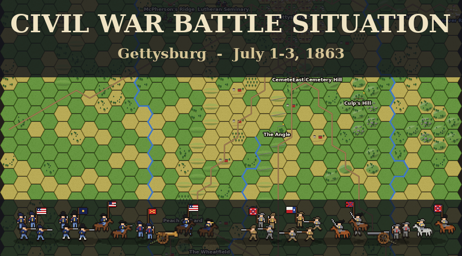
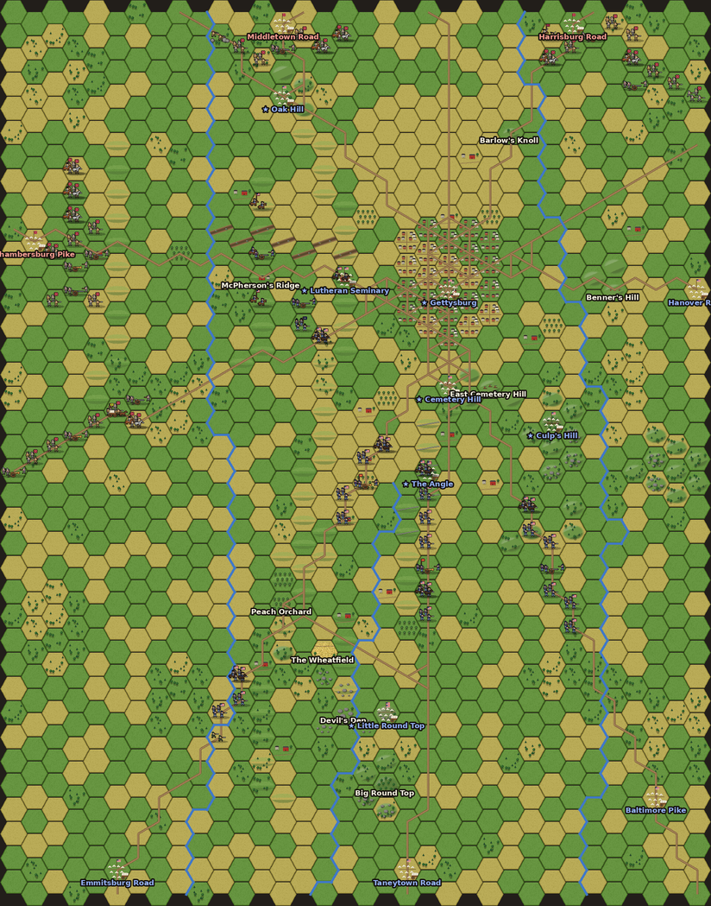

# Civil War Battle Situation — an Unciv mod



A Civil War ruleset for [Unciv](https://github.com/yairm210/Unciv), starting with the **Battle of Gettysburg, July 1–3, 1863**.

* **Gettysburg scenario** – a big battle from the first turn. Everything that reached the field on July 1 starts on the map, in every sector: 36 Union and 47 Confederate units. The rest of both armies then arrives on its historical road at its historical hour: 93 Union and 77 Confederate units in total. Seven **key positions** (cities on Oak Hill, the Lutheran Seminary, the town, Cemetery Hill, Culp's Hill, the Angle and Little Round Top) decide who holds the field.
* **Gettysburg map** – a 34 × 37 hex map of the battlefield (about 250 yards per hex). It includes Seminary, Cemetery, McPherson's and Herr Ridges, Oak Hill, Culp's Hill and the Round Tops, Devil's Den, the Wheatfield and Peach Orchard, the town, the stone wall at the Angle, the unfinished railroad cut, Willoughby Run, Plum Run, Rock Creek and the ten roads that met at Gettysburg.
* **30 units** with original pixel art (map sprites, full-color portraits and icons), for the Union, the Confederacy and a neutral base set. Each is modeled on its real weapons and tactics, from the Springfield rifle-musket and the 12-pounder Napoleon to Berdan's Sharps rifles, Custer's Spencers and Hurt's Whitworths.
* **30 named generals** with personal abilities (Hancock the Superb, Buford's eye for ground, Hunt's artillery, Lee, Longstreet, Stuart…), plus sepia portraits of Meade and Lee.
* **15 landmarks** with their own art and history. Seven of them are the scenario's key positions.



---

## Install

You need **Unciv 4.22.9 or newer** (the scenario was built with 4.22.9, and older versions may refuse to load it).

1. In Unciv, open **Mods** → **Download mod from URL**.
2. Paste `https://github.com/ryflan3/Civil-War-Battle-Situation` and press **Download**.
3. Check that the mod appears in the Mods list as exactly **Civil War Battle Situation**.

The installed name must be exactly that, because the scenario and the map refer to the ruleset by name. Unciv builds the name from the repository name and the default branch, so the default branch must be a simple name such as `main` (see *Final steps* below). If the mod shows up with extra words, such as *Civil War Battle Situation claude unciv civil war mod …*, see *Troubleshooting*.

Once the repository has the `unciv-mod` topic (see *Final steps* below), it also appears in Unciv's built-in mod list.

## Play the Battle of Gettysburg

1. **New Game** → **Map Type: Scenario**, then choose a Gettysburg scenario. The scenario sets everything else: the base ruleset changes to **Civil War Battle Situation**, and the player list shows the **Union** (Human) and the **Confederacy** (AI). Each scenario is the same battle at a different difficulty. Difficulty sets how strong the AI-controlled army fights:

   | Scenario | Difficulty | AI army strength |
   |---|---|---|
   | Battle of Gettysburg (Easiest - Militia) | Militia | −15% |
   | Battle of Gettysburg (Easier - Volunteers) | Volunteers | −5% |
   | **Battle of Gettysburg** | Veterans | normal |
   | Battle of Gettysburg (Harder - Regulars) | Regulars | +10% |
   | Battle of Gettysburg (Hardest - Iron Brigade) | Iron Brigade | +20% |

2. **Choose your side.** By default you command the Union. To play the Confederacy, click **Human** next to the Union to make it **AI**, then click **AI** next to the Confederacy to make it **Human**. Set both to Human for a two-player hotseat game.
3. **Start game!**

A scenario is a battle that is already set up, so Unciv locks the other New Game options while one is selected: the base ruleset, the map, which nations take part, the difficulty and the game options. This is normal. Only the Human/AI buttons stay open. The locked options panel still shows your last game's settings, not the scenario's. What the scenario actually uses:

* **At war from the first turn.** The war cannot end in peace.
* **The terrain is revealed and units are hidden.** Both commanders have maps, so you see the whole battlefield, but enemy troops only appear where your own units can see them.
* **No barbarians.**
* **Cities cannot be razed.** A captured city stays on the map and can be taken back.
* **No new units.** Cities cannot raise any: the armies are the historical ones.

**Scale.** One hex is about 250 yards. One turn is about one hour of daylight, and each night is compressed into two turns.

| Turn | Time |
|---|---|
| 0 – 12 | July 1, 7 AM – 7 PM |
| 13 – 14 | Night of July 1–2 |
| 15 – 30 | July 2, 5 AM – 8 PM |
| 31 – 32 | Night of July 2–3 |
| 33 – 47 | July 3, 5 AM – 7 PM |

**On the field at the start.** To make the battle big from the first turn, the marches of July 1 are compressed. Every force that reached Gettysburg that day starts on the map, in or near the ground it fought over:

* **Union:** Buford's cavalry west of town, Wadsworth's division behind him at the Seminary, the rest of the I Corps and the XI Corps around the Angle and the Taneytown Road, the XII Corps on the Baltimore Pike, and the III Corps coming up the Emmitsburg Road.
* **Confederacy:** Heth's, Pender's and Anderson's divisions to the west, Rodes's division north of Oak Hill, and Early's and Johnson's divisions on the Harrisburg Road to the northeast.

**Key positions.** Seven cities stand on Oak Hill, the Lutheran Seminary, the town of Gettysburg, Cemetery Hill, Culp's Hill, the Angle and Little Round Top. All of them start in Union hands, so the Confederates must take them and the Union must hold them. They are stronger than ordinary towns, and they are never burned: whoever captures one keeps it until the enemy takes it back.

**Reinforcements** from the night of July 1–2 onward appear at the start of their turn in or next to their entry city: Taneytown Road (Meade's HQ), Emmitsburg Road, Baltimore Pike and Hanover Road for the Union; Chambersburg Pike (Lee's HQ) and Harrisburg Road for the Confederacy. The full order of battle is in [docs/ORDER_OF_BATTLE.md](docs/ORDER_OF_BATTLE.md), and in-game in the Civilopedia under each "Arrivals" building. If the enemy captures an entry city, the reinforcements still due on that road are lost.

**Victory**

* **Hold the Field** – from the end of turn 47 (nightfall, July 3), the army holding more of the seven **key positions** wins. In 1863 the Confederates took Oak Hill, the seminary and the town, but the Union kept the other four, and Lee retreated.
* **Decisive Victory** – capture the enemy army's headquarters at any time.

**Tactics of 1863**

* Rifle-muskets made frontal attacks costly. Fight from woods, walls, breastworks and high ground.
* Attack a unit from several sides: every extra adjacent unit adds a flanking bonus.
* Artillery must **Set Up** before firing and needs line of sight, so put it on hills.
* Generals inspire troops within range, but a general caught by the enemy is killed.

## Other ways to play

* **Custom map:** New Game → base ruleset **Civil War Battle Situation** → **Map Type: Custom** → map **Gettysburg**. Pick your nation and the AI's nation in the player list as in any Unciv game. Each side starts with a Supply Train (founds an HQ), Pioneers and a small army, and builds the rest. The historical armies, key positions and arrival timetable are only in the scenario. The terrain is revealed from turn 1, and there are never barbarians. Unciv's AI does not start wars in a battle this small, so **declare war yourself on turn 1**: open **Diplomacy** (top left), select the enemy and choose *Declare war*.
* **Random maps:** pick **Civil War Battle Situation** as the base ruleset on any generated map.
* **Map editor:** the Gettysburg map can be opened and edited in Unciv's map editor.

## Troubleshooting

**Picking a Gettysburg scenario resets the Base Ruleset to a Civ V ruleset, the players turn into "Random", nothing can be changed, and Start says "It looks like we can't make a map with the parameters you requested!"**

Your copy of the mod is installed under the wrong name, so Unciv can't find the *Civil War Battle Situation* ruleset that the scenario needs. The custom map still works with a wrongly named copy, which makes this easy to miss.

**Check:** on the New Game screen, open the **Base Ruleset** list. It must contain exactly `Civil War Battle Situation`. A longer name, such as `Civil War Battle Situation claude unciv civil war mod j2xmgj` or `Civil War Battle Situation main`, is a broken copy. It comes from a download made while the repository's default branch was not `main`, or from a link to a specific branch.

**Fix:**

1. In Unciv, open **Mods** and **delete every copy** of the mod.
2. Install it again in either of these ways:
   * from the **Downloadable mods** list in the Mods screen, or
   * with **Download mod from URL** and exactly `https://github.com/ryflan3/Civil-War-Battle-Situation`.
3. Check that the Mods list shows exactly **Civil War Battle Situation**.

On desktop you can instead rename the folder inside Unciv's `mods` folder to exactly `Civil War Battle Situation`.

## The rules in brief

**Armies**

* **Union – Arsenal of the Union:** +15% Strength for artillery when attacking (better ammunition and Hunt's artillery organization). +5 HP healing for land units (Letterman's ambulance system). Union infantry get +10% (60 rounds per man, standardized Springfields).
* **Confederacy – Lee's Invincibles:** +15% Strength for cavalry when attacking (superb horsemen). +5 HP healing in enemy territory (foraging). Confederate infantry get +10% when attacking (the Rebel Yell).

**Unit types**

| Type | Role |
|---|---|
| Infantry | Brigades with rifle-muskets. Can build Breastworks (+50% defense) in 2 turns. |
| Skirmisher | Sharpshooters: range 2, +50% vs artillery, strong in rough terrain, usually slip away from melee. |
| Cavalry | Fast and far-seeing, can move after attacking and often withdraw. Weak when charging infantry. |
| Artillery | Must set up; entering rough terrain ends its move. Napoleons fire canister (+50% defending vs infantry and cavalry). Rifled guns have range 3 and win counter-battery duels. The Whitworth reaches 4 hexes. |
| Commander | Generals: an aura of +15% within 2 hexes, plus a personal ability. |
| Support | Supply Train (founds depots), Pioneers (breastworks, roads, clearing woods), Field Hospital / Union Ambulance Corps (heal adjacent units). |

Elite units: **Iron Brigade**, **Michigan Cavalry Brigade** (Spencer repeaters), **Texas Brigade**, **Stonewall Brigade** and the **Whitworth Battery**. Full stats are in [docs/UNITS.md](docs/UNITS.md).

**Terrain**

| Terrain | Move | Defense | Notes |
|---|---|---|---|
| Meadow (Grassland) / Fields (Plains) | 1 | – | open ground |
| Ridge | 1 | +15% | elevation 1: see and shoot over lower ground |
| Hill | 2 | +25% | elevation 1, rough |
| Woods (Forest) | 2 | +25% | blocks line of sight |
| Orchard | 1 | +10% | |
| Boulders | 3 | +50% | rough, blocks line of sight |
| Town | 2 | +30% | blocks line of sight |
| Stone Wall | 2 | +40% | |
| Farmstead | 1 | +20% | stone houses and barns |
| Railroad Cut | 2 | −25% | a trap: steep walls, nowhere to fire from |
| Marsh | 3 | −15% | |
| Creeks | – | – | crossing uses all movement, attacking across is −20%; roads have bridges |
| Roads | ⅓ | – | marching columns move three times as fast |

The landmarks (Cemetery Hill, Culp's Hill, Little Round Top, Big Round Top, Devil's Den, the Angle, the Peach Orchard, the Wheatfield, the Lutheran Seminary, Oak Hill, McPherson's Ridge, Barlow's Knoll, Benner's Hill, the town square) are special tiles with their own art, defense and elevation. Each has a Civilopedia entry with its history.

---

## Final steps for you

1. ✅ **Rename the default branch to `main` (required, done).** Unciv downloads a mod from the repository's default branch and names the mod after the repository and that branch. It only strips simple branch names cleanly: with `claude/unciv-civil-war-mod-j2xmgj`, the mod installs under the wrong name and the scenario cannot start (see *Troubleshooting*). On GitHub, open the repository → **Settings** → **General** → **Default branch**, click the pencil icon (*Rename branch*), type `main` and confirm. GitHub moves all the files and history to `main` and redirects links to the old name.
2. ✅ **Add GitHub topics** (done) so Unciv's mod browser lists the mod: on the repository page, click the gear next to *About* and add `unciv-mod`, `unciv-mod-rulesets` and `unciv-mod-maps`.
3. **Install and test in Unciv** (see *Install* above), then play a few turns of the scenario as each side.
4. **Optional:** add a `LICENSE` file if you want others to reuse the mod (MIT or CC-BY are common for Unciv mods).

## Editing the mod

Most JSON files and **all images** are generated by the scripts in `tools/`. Edit the scripts, not the generated files, then rebuild.

| You want to change… | Edit |
|---|---|
| Unit stats and abilities | `tools/gen_units.py` |
| Promotions and generals' abilities | `tools/gen_promotions.py` |
| The order of battle, key positions, opening deployment, arrival times and entry roads | `tools/gettysburg_oob.py` |
| The map's geography | `tools/gettysburg_geo.py` |
| Graphics | `tools/art/*.py` |
| Nations, terrain, eras, victories, difficulties, global rules | the hand-written files in `jsons/` (`Nations.json`, `Terrains.json`, `Eras.json`, `VictoryTypes.json`, `Difficulties.json`, `GlobalUniques.json`, `ModOptions.json`, …) |

Then run:

```bash
tools/build_all.sh              # regenerate everything and run Unciv's validator
tools/build_all.sh --simulate   # ...and let the AI play the whole battle as a smoke test
```

This needs Python 3 with Pillow, Java 21 and internet access. The first run downloads the official `Unciv.jar` (4.22.9) and Gradle. The build uses the real Unciv engine to pack the texture atlas (`game.atlas`/`game.png`), write `maps/Gettysburg` and the scenario saves in `scenarios/`, and run Unciv's own ruleset validator.

You can also simply start the desktop version of Unciv with this folder in its `mods` directory: it re-packs the atlas itself whenever images change.

### Repository layout

```
jsons/          ruleset (Units, UnitTypes, UnitPromotions, Nations, Terrains, Buildings, TileImprovements, ...)
jsons/TileSets/ how the HexaRealm and FantasyHex tilesets layer the new terrain
Images/         source images (unit sprites, portraits, icons, terrain overlays, leaders, emblems)
game.atlas, game.png, Atlases.json   packed textures the game loads
maps/Gettysburg                       the map (also usable in the map editor)
scenarios/                            the Gettysburg scenario, one save per difficulty
docs/           order of battle, unit reference, map picture
tools/          generators and the Unciv-engine build tool (tools/cwtool)
```

## How it was checked

* Unciv 4.22.9's own ruleset validator (the in-game "Locate mod errors" check) reports **no problems**.
* The map and the scenario were written and read back by the real Unciv 4.22.9 engine.
* Unciv's own *Download mod from URL* code was run on this repository's GitHub archives. It installs the mod as **Civil War Battle Situation** when the default branch is `main`, and the scenario then starts.
* The scenario was loaded the same way the New Game screen loads it, and the computer played the whole battle from each seat. The armies started at war, with the terrain revealed and enemy units hidden, and with no barbarians. Every arrival appeared on its turn with its historical name, and no city was razed. In one test game the Confederates took Oak Hill, the seminary and Cemetery Hill, and the Union won Hold the Field by four key positions to three. In the other, the Union counterattacked and captured Lee's headquarters for a Decisive Victory. Expect a hard fight; if it is too hard, pick an *Easier* or *Easiest* scenario.

## Notes

* All graphics were drawn from scratch by the scripts in `tools/art`; no images were copied from Unciv or elsewhere. Flags are shown as the armies carried them in 1863, for historical accuracy.
* Lee's greetings *"If the enemy is there tomorrow, we must attack him"* and *"It is all my fault"* are his recorded words. The other leader lines are written for the game.
